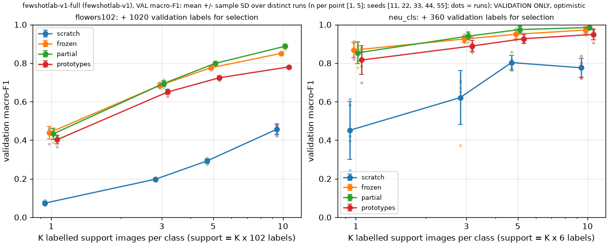

# fewshotlab-v1-full: validation aggregates by K and method

> **VALIDATION ONLY: development results. Each learned checkpoint was selected on these same validation images, so the numbers are optimistic. They are not held-out test results.**

Generated 2026-11-02T06:27:09Z from stored predictions (protocol fewshotlab-v1). Slots: {'COMPLETED': 156, 'DEDUPLICATED': 4}. Cells show mean +/- sample SD over distinct runs, with the distinct run count in brackets. SD is null when fewer than two distinct runs exist; a deterministic duplicate counts once.

## flowers102 (102 classes; 1020 validation labels used for checkpoint selection)

Macro-F1 (primary):

| K | support labels | scratch | frozen | partial | prototypes |
|---:|---:|---:|---:|---:|---:|
| 1 | 102 | 0.074 +/- 0.009 [5] | 0.439 +/- 0.033 [5] | 0.433 +/- 0.030 [5] | 0.403 +/- 0.023 [5] |
| 3 | 306 | 0.198 +/- 0.008 [5] | 0.685 +/- 0.011 [5] | 0.695 +/- 0.015 [5] | 0.650 +/- 0.013 [5] |
| 5 | 510 | 0.292 +/- 0.011 [5] | 0.776 +/- 0.010 [5] | 0.799 +/- 0.009 [5] | 0.724 +/- 0.010 [5] |
| 10 | 1020 | 0.457 +/- 0.028 [5] | 0.850 +/- 0.002 [5] | 0.887 +/- 0.011 [5] | 0.780 +/- null [1] |

Top-1 and balanced accuracy (mean over distinct runs):

| K | scratch top-1 / bal. | frozen top-1 / bal. | partial top-1 / bal. | prototypes top-1 / bal. |
|---:|---|---|---|---|
| 1 | 0.090 / 0.090 | 0.453 / 0.453 | 0.447 / 0.447 | 0.419 / 0.419 |
| 3 | 0.212 / 0.212 | 0.691 / 0.691 | 0.700 / 0.700 | 0.654 / 0.654 |
| 5 | 0.300 / 0.300 | 0.779 / 0.779 | 0.801 / 0.801 | 0.728 / 0.728 |
| 10 | 0.465 / 0.465 | 0.850 / 0.850 | 0.889 / 0.889 | 0.781 / 0.781 |

Paired macro-F1 differences (A - B, matched support seeds):

| K | A - B | n pairs | mean | SD | min | max | A better |
|---:|---|---:|---:|---:|---:|---:|---:|
| 1 | frozen - scratch | 5 | 0.365 | 0.033 | 0.311 | 0.401 | 5/5 |
| 1 | partial - scratch | 5 | 0.359 | 0.026 | 0.317 | 0.385 | 5/5 |
| 1 | prototypes - scratch | 5 | 0.329 | 0.025 | 0.293 | 0.350 | 5/5 |
| 1 | partial - frozen | 5 | -0.006 | 0.020 | -0.038 | 0.008 | 3/5 |
| 1 | prototypes - frozen | 5 | -0.036 | 0.018 | -0.057 | -0.017 | 0/5 |
| 1 | partial - prototypes | 5 | 0.030 | 0.023 | 0.007 | 0.064 | 5/5 |
| 3 | frozen - scratch | 5 | 0.487 | 0.010 | 0.479 | 0.504 | 5/5 |
| 3 | partial - scratch | 5 | 0.497 | 0.013 | 0.480 | 0.510 | 5/5 |
| 3 | prototypes - scratch | 5 | 0.452 | 0.009 | 0.440 | 0.463 | 5/5 |
| 3 | partial - frozen | 5 | 0.010 | 0.015 | -0.007 | 0.030 | 4/5 |
| 3 | prototypes - frozen | 5 | -0.035 | 0.007 | -0.042 | -0.026 | 0/5 |
| 3 | partial - prototypes | 5 | 0.044 | 0.017 | 0.025 | 0.062 | 5/5 |
| 5 | frozen - scratch | 5 | 0.484 | 0.013 | 0.467 | 0.499 | 5/5 |
| 5 | partial - scratch | 5 | 0.506 | 0.016 | 0.491 | 0.528 | 5/5 |
| 5 | prototypes - scratch | 5 | 0.431 | 0.017 | 0.412 | 0.450 | 5/5 |
| 5 | partial - frozen | 5 | 0.022 | 0.007 | 0.013 | 0.029 | 5/5 |
| 5 | prototypes - frozen | 5 | -0.053 | 0.008 | -0.065 | -0.042 | 0/5 |
| 5 | partial - prototypes | 5 | 0.075 | 0.003 | 0.071 | 0.078 | 5/5 |
| 10 | frozen - scratch | 5 | 0.394 | 0.027 | 0.368 | 0.429 | 5/5 |
| 10 | partial - scratch | 5 | 0.431 | 0.036 | 0.394 | 0.475 | 5/5 |
| 10 | prototypes - scratch (one distinct run on a side) | 5 | 0.324 | 0.028 | 0.299 | 0.359 | 5/5 |
| 10 | partial - frozen | 5 | 0.037 | 0.012 | 0.018 | 0.048 | 5/5 |
| 10 | prototypes - frozen (one distinct run on a side) | 5 | -0.070 | 0.002 | -0.073 | -0.068 | 0/5 |
| 10 | partial - prototypes (one distinct run on a side) | 5 | 0.107 | 0.011 | 0.091 | 0.117 | 5/5 |

## neu_cls (6 classes; 360 validation labels used for checkpoint selection)

Macro-F1 (primary):

| K | support labels | scratch | frozen | partial | prototypes |
|---:|---:|---:|---:|---:|---:|
| 1 | 6 | 0.451 +/- 0.150 [5] | 0.868 +/- 0.041 [5] | 0.854 +/- 0.057 [5] | 0.816 +/- 0.075 [5] |
| 3 | 18 | 0.621 +/- 0.140 [5] | 0.925 +/- 0.016 [5] | 0.940 +/- 0.020 [5] | 0.889 +/- 0.030 [5] |
| 5 | 30 | 0.803 +/- 0.038 [5] | 0.950 +/- 0.023 [5] | 0.974 +/- 0.018 [5] | 0.927 +/- 0.023 [5] |
| 10 | 60 | 0.776 +/- 0.050 [5] | 0.972 +/- 0.017 [5] | 0.985 +/- 0.007 [5] | 0.949 +/- 0.027 [5] |

Top-1 and balanced accuracy (mean over distinct runs):

| K | scratch top-1 / bal. | frozen top-1 / bal. | partial top-1 / bal. | prototypes top-1 / bal. |
|---:|---|---|---|---|
| 1 | 0.468 / 0.468 | 0.868 / 0.868 | 0.856 / 0.856 | 0.818 / 0.818 |
| 3 | 0.634 / 0.634 | 0.926 / 0.926 | 0.941 / 0.941 | 0.890 / 0.890 |
| 5 | 0.807 / 0.807 | 0.950 / 0.950 | 0.974 / 0.974 | 0.927 / 0.927 |
| 10 | 0.782 / 0.782 | 0.972 / 0.972 | 0.985 / 0.985 | 0.949 / 0.949 |

Paired macro-F1 differences (A - B, matched support seeds):

| K | A - B | n pairs | mean | SD | min | max | A better |
|---:|---|---:|---:|---:|---:|---:|---:|
| 1 | frozen - scratch | 5 | 0.417 | 0.112 | 0.291 | 0.577 | 5/5 |
| 1 | partial - scratch | 5 | 0.402 | 0.107 | 0.270 | 0.535 | 5/5 |
| 1 | prototypes - scratch | 5 | 0.365 | 0.087 | 0.266 | 0.456 | 5/5 |
| 1 | partial - frozen | 5 | -0.014 | 0.025 | -0.042 | 0.023 | 1/5 |
| 1 | prototypes - frozen | 5 | -0.052 | 0.042 | -0.121 | -0.012 | 0/5 |
| 1 | partial - prototypes | 5 | 0.037 | 0.028 | 0.003 | 0.079 | 5/5 |
| 3 | frozen - scratch | 5 | 0.304 | 0.153 | 0.209 | 0.575 | 5/5 |
| 3 | partial - scratch | 5 | 0.319 | 0.153 | 0.207 | 0.587 | 5/5 |
| 3 | prototypes - scratch | 5 | 0.268 | 0.165 | 0.156 | 0.559 | 5/5 |
| 3 | partial - frozen | 5 | 0.015 | 0.011 | -0.002 | 0.028 | 4/5 |
| 3 | prototypes - frozen | 5 | -0.036 | 0.014 | -0.053 | -0.016 | 0/5 |
| 3 | partial - prototypes | 5 | 0.051 | 0.016 | 0.028 | 0.072 | 5/5 |
| 5 | frozen - scratch | 5 | 0.147 | 0.043 | 0.090 | 0.200 | 5/5 |
| 5 | partial - scratch | 5 | 0.171 | 0.046 | 0.107 | 0.230 | 5/5 |
| 5 | prototypes - scratch | 5 | 0.124 | 0.053 | 0.047 | 0.192 | 5/5 |
| 5 | partial - frozen | 5 | 0.024 | 0.009 | 0.014 | 0.036 | 5/5 |
| 5 | prototypes - frozen | 5 | -0.023 | 0.015 | -0.042 | -0.008 | 0/5 |
| 5 | partial - prototypes | 5 | 0.048 | 0.007 | 0.038 | 0.059 | 5/5 |
| 10 | frozen - scratch | 5 | 0.196 | 0.050 | 0.147 | 0.261 | 5/5 |
| 10 | partial - scratch | 5 | 0.209 | 0.050 | 0.147 | 0.269 | 5/5 |
| 10 | prototypes - scratch | 5 | 0.173 | 0.063 | 0.107 | 0.253 | 5/5 |
| 10 | partial - frozen | 5 | 0.013 | 0.012 | -0.000 | 0.033 | 4/5 |
| 10 | prototypes - frozen | 5 | -0.023 | 0.015 | -0.040 | -0.008 | 0/5 |
| 10 | partial - prototypes | 5 | 0.036 | 0.021 | 0.016 | 0.071 | 5/5 |

Notes:

- Values are fractions in [0, 1]; `null` means not measured.
- Seeds vary the support images and the initialization stream together. The spread describes this benchmark's variability across five support draws, not a population confidence interval.
- Every value regenerates from stored prediction files; per-slot rows are in the CSV.
- Validation values are optimistic: the selection rule (best validation macro-F1 epoch) used the same images.
