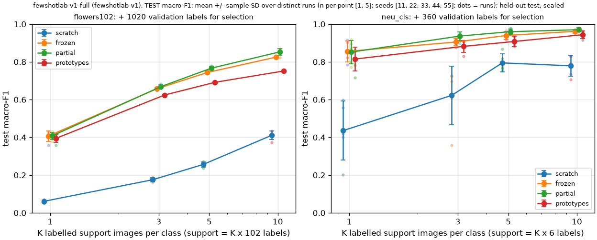

# fewshotlab-v1-full: held-out test aggregates by K and method

> **HELD-OUT TEST under a sealed plan: every model, threshold and rule was fixed on validation before test access, and each run was evaluated on test once.**

Generated 2026-11-02T07:20:04Z from stored predictions (protocol fewshotlab-v1). Slots: {'EVALUATED': 156, 'DEDUPLICATED': 4}. Cells show mean +/- sample SD over distinct runs, with the distinct run count in brackets. SD is null when fewer than two distinct runs exist; a deterministic duplicate counts once.

## flowers102 (102 classes; 1020 validation labels used for checkpoint selection)

Macro-F1 (primary):

| K | support labels | scratch | frozen | partial | prototypes |
|---:|---:|---:|---:|---:|---:|
| 1 | 102 | 0.061 +/- 0.008 [5] | 0.406 +/- 0.028 [5] | 0.408 +/- 0.020 [5] | 0.394 +/- 0.020 [5] |
| 3 | 306 | 0.175 +/- 0.011 [5] | 0.657 +/- 0.007 [5] | 0.668 +/- 0.011 [5] | 0.624 +/- 0.003 [5] |
| 5 | 510 | 0.256 +/- 0.013 [5] | 0.744 +/- 0.002 [5] | 0.766 +/- 0.010 [5] | 0.692 +/- 0.003 [5] |
| 10 | 1020 | 0.411 +/- 0.022 [5] | 0.825 +/- 0.003 [5] | 0.853 +/- 0.017 [5] | 0.751 +/- null [1] |

Top-1 and balanced accuracy (mean over distinct runs):

| K | scratch top-1 / bal. | frozen top-1 / bal. | partial top-1 / bal. | prototypes top-1 / bal. |
|---:|---|---|---|---|
| 1 | 0.075 / 0.084 | 0.418 / 0.447 | 0.417 / 0.447 | 0.404 / 0.429 |
| 3 | 0.186 / 0.206 | 0.667 / 0.691 | 0.674 / 0.702 | 0.631 / 0.650 |
| 5 | 0.266 / 0.285 | 0.751 / 0.775 | 0.773 / 0.797 | 0.699 / 0.719 |
| 10 | 0.415 / 0.447 | 0.827 / 0.853 | 0.855 / 0.876 | 0.755 / 0.778 |

Paired macro-F1 differences (A - B, matched support seeds):

| K | A - B | n pairs | mean | SD | min | max | A better |
|---:|---|---:|---:|---:|---:|---:|---:|
| 1 | frozen - scratch | 5 | 0.345 | 0.029 | 0.297 | 0.366 | 5/5 |
| 1 | partial - scratch | 5 | 0.347 | 0.018 | 0.319 | 0.364 | 5/5 |
| 1 | prototypes - scratch | 5 | 0.333 | 0.022 | 0.299 | 0.358 | 5/5 |
| 1 | partial - frozen | 5 | 0.001 | 0.020 | -0.018 | 0.022 | 2/5 |
| 1 | prototypes - frozen | 5 | -0.012 | 0.010 | -0.026 | 0.002 | 1/5 |
| 1 | partial - prototypes | 5 | 0.013 | 0.015 | -0.005 | 0.035 | 4/5 |
| 3 | frozen - scratch | 5 | 0.482 | 0.009 | 0.472 | 0.491 | 5/5 |
| 3 | partial - scratch | 5 | 0.493 | 0.016 | 0.472 | 0.512 | 5/5 |
| 3 | prototypes - scratch | 5 | 0.449 | 0.008 | 0.439 | 0.459 | 5/5 |
| 3 | partial - frozen | 5 | 0.011 | 0.012 | -0.002 | 0.022 | 3/5 |
| 3 | prototypes - frozen | 5 | -0.033 | 0.006 | -0.038 | -0.024 | 0/5 |
| 3 | partial - prototypes | 5 | 0.044 | 0.012 | 0.033 | 0.061 | 5/5 |
| 5 | frozen - scratch | 5 | 0.487 | 0.011 | 0.473 | 0.503 | 5/5 |
| 5 | partial - scratch | 5 | 0.510 | 0.011 | 0.497 | 0.523 | 5/5 |
| 5 | prototypes - scratch | 5 | 0.435 | 0.012 | 0.424 | 0.455 | 5/5 |
| 5 | partial - frozen | 5 | 0.023 | 0.010 | 0.008 | 0.036 | 5/5 |
| 5 | prototypes - frozen | 5 | -0.052 | 0.004 | -0.057 | -0.048 | 0/5 |
| 5 | partial - prototypes | 5 | 0.075 | 0.009 | 0.065 | 0.088 | 5/5 |
| 10 | frozen - scratch | 5 | 0.414 | 0.023 | 0.392 | 0.451 | 5/5 |
| 10 | partial - scratch | 5 | 0.442 | 0.034 | 0.388 | 0.481 | 5/5 |
| 10 | prototypes - scratch (one distinct run on a side) | 5 | 0.341 | 0.022 | 0.317 | 0.377 | 5/5 |
| 10 | partial - frozen | 5 | 0.028 | 0.019 | -0.004 | 0.043 | 4/5 |
| 10 | prototypes - frozen (one distinct run on a side) | 5 | -0.073 | 0.003 | -0.077 | -0.069 | 0/5 |
| 10 | partial - prototypes (one distinct run on a side) | 5 | 0.101 | 0.017 | 0.071 | 0.113 | 5/5 |

## neu_cls (6 classes; 360 validation labels used for checkpoint selection)

Macro-F1 (primary):

| K | support labels | scratch | frozen | partial | prototypes |
|---:|---:|---:|---:|---:|---:|
| 1 | 6 | 0.436 +/- 0.156 [5] | 0.855 +/- 0.055 [5] | 0.852 +/- 0.063 [5] | 0.815 +/- 0.064 [5] |
| 3 | 18 | 0.623 +/- 0.155 [5] | 0.905 +/- 0.019 [5] | 0.937 +/- 0.022 [5] | 0.882 +/- 0.032 [5] |
| 5 | 30 | 0.794 +/- 0.048 [5] | 0.940 +/- 0.021 [5] | 0.960 +/- 0.014 [5] | 0.908 +/- 0.027 [5] |
| 10 | 60 | 0.779 +/- 0.056 [5] | 0.962 +/- 0.009 [5] | 0.970 +/- 0.010 [5] | 0.944 +/- 0.021 [5] |

Top-1 and balanced accuracy (mean over distinct runs):

| K | scratch top-1 / bal. | frozen top-1 / bal. | partial top-1 / bal. | prototypes top-1 / bal. |
|---:|---|---|---|---|
| 1 | 0.452 / 0.452 | 0.857 / 0.857 | 0.854 / 0.854 | 0.819 / 0.819 |
| 3 | 0.637 / 0.637 | 0.907 / 0.907 | 0.938 / 0.938 | 0.883 / 0.883 |
| 5 | 0.801 / 0.801 | 0.940 / 0.940 | 0.960 / 0.960 | 0.908 / 0.908 |
| 10 | 0.786 / 0.786 | 0.962 / 0.962 | 0.971 / 0.971 | 0.944 / 0.944 |

Paired macro-F1 differences (A - B, matched support seeds):

| K | A - B | n pairs | mean | SD | min | max | A better |
|---:|---|---:|---:|---:|---:|---:|---:|
| 1 | frozen - scratch | 5 | 0.420 | 0.105 | 0.305 | 0.582 | 5/5 |
| 1 | partial - scratch | 5 | 0.416 | 0.104 | 0.297 | 0.571 | 5/5 |
| 1 | prototypes - scratch | 5 | 0.379 | 0.103 | 0.258 | 0.517 | 5/5 |
| 1 | partial - frozen | 5 | -0.004 | 0.016 | -0.022 | 0.019 | 2/5 |
| 1 | prototypes - frozen | 5 | -0.041 | 0.027 | -0.066 | 0.005 | 1/5 |
| 1 | partial - prototypes | 5 | 0.037 | 0.020 | 0.015 | 0.057 | 5/5 |
| 3 | frozen - scratch | 5 | 0.283 | 0.166 | 0.151 | 0.565 | 5/5 |
| 3 | partial - scratch | 5 | 0.314 | 0.163 | 0.173 | 0.585 | 5/5 |
| 3 | prototypes - scratch | 5 | 0.260 | 0.165 | 0.158 | 0.552 | 5/5 |
| 3 | partial - frozen | 5 | 0.032 | 0.011 | 0.020 | 0.049 | 5/5 |
| 3 | prototypes - frozen | 5 | -0.023 | 0.029 | -0.069 | 0.007 | 1/5 |
| 3 | partial - prototypes | 5 | 0.055 | 0.039 | 0.015 | 0.118 | 5/5 |
| 5 | frozen - scratch | 5 | 0.145 | 0.051 | 0.082 | 0.195 | 5/5 |
| 5 | partial - scratch | 5 | 0.165 | 0.057 | 0.082 | 0.225 | 5/5 |
| 5 | prototypes - scratch | 5 | 0.113 | 0.063 | 0.032 | 0.178 | 5/5 |
| 5 | partial - frozen | 5 | 0.020 | 0.016 | 0.000 | 0.034 | 5/5 |
| 5 | prototypes - frozen | 5 | -0.032 | 0.014 | -0.051 | -0.014 | 0/5 |
| 5 | partial - prototypes | 5 | 0.052 | 0.015 | 0.030 | 0.066 | 5/5 |
| 10 | frozen - scratch | 5 | 0.183 | 0.063 | 0.122 | 0.265 | 5/5 |
| 10 | partial - scratch | 5 | 0.191 | 0.062 | 0.127 | 0.268 | 5/5 |
| 10 | prototypes - scratch | 5 | 0.165 | 0.057 | 0.121 | 0.251 | 5/5 |
| 10 | partial - frozen | 5 | 0.009 | 0.004 | 0.003 | 0.014 | 5/5 |
| 10 | prototypes - frozen | 5 | -0.018 | 0.020 | -0.036 | 0.011 | 1/5 |
| 10 | partial - prototypes | 5 | 0.027 | 0.023 | -0.006 | 0.050 | 4/5 |

Notes:

- Values are fractions in [0, 1]; `null` means not measured.
- Seeds vary the support images and the initialization stream together. The spread describes this benchmark's variability across five support draws, not a population confidence interval.
- Every value regenerates from stored prediction files; per-slot rows are in the CSV.
