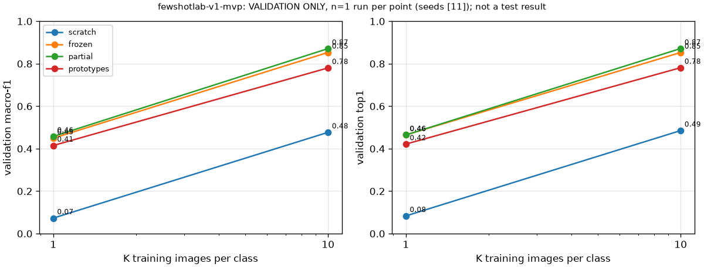

# fewshotlab-v1-mvp: validation comparison

> **VALIDATION ONLY: exploratory development results, n = 1 run per cell. Each learned model's checkpoint was selected on these same validation images, so its numbers are optimistic. None of them is a held-out test result, and they are not comparable with published Flowers102 test benchmarks.**

Generated 2026-11-01T18:13:14Z from the run ledger and the stored prediction files. Slot statuses: {'COMPLETED': 8}. Every metric value regenerates from its run's `predictions_val.csv`.

| Dataset | K | Method | Status | Macro-F1 | Top-1 | Balanced acc. | Top-5 | Selected epoch | Epochs run | Optimizer steps | Trainable params | Fit / val labels | Wall time (s) |
|---|---:|---|---|---:|---:|---:|---:|---:|---:|---:|---:|---|---:|
| flowers102 | 1 | scratch | COMPLETED | 0.073 | 0.083 | 0.083 | 0.235 | 34 | 49 | 196 | 11228838 | 102 / 1020 | 168.2 |
| flowers102 | 1 | frozen | COMPLETED | 0.449 | 0.465 | 0.465 | 0.699 | 33 | 48 | 192 | 52326 | 102 / 1020 | 149.4 |
| flowers102 | 1 | partial | COMPLETED | 0.458 | 0.465 | 0.465 | 0.723 | 71 | 86 | 344 | 8446054 | 102 / 1020 | 273.0 |
| flowers102 | 1 | prototypes | COMPLETED | 0.415 | 0.422 | 0.422 | 0.668 | class means (no epochs) | 0 | 0 | 0 | 102 / 1020 | 6.1 |
| flowers102 | 10 | scratch | COMPLETED | 0.477 | 0.485 | 0.485 | 0.757 | 70 | 85 | 2720 | 11228838 | 1020 / 1020 | 722.8 |
| flowers102 | 10 | frozen | COMPLETED | 0.853 | 0.853 | 0.853 | 0.964 | 49 | 52 | 1664 | 52326 | 1020 / 1020 | 289.7 |
| flowers102 | 10 | partial | COMPLETED | 0.871 | 0.872 | 0.872 | 0.967 | 22 | 37 | 1184 | 8446054 | 1020 / 1020 | 229.9 |
| flowers102 | 10 | prototypes | COMPLETED | 0.780 | 0.781 | 0.781 | 0.931 | class means (no epochs) | 0 | 0 | 0 | 1020 / 1020 | 8.7 |

Values are fractions in [0, 1]. `null` means not measured.

## Run evidence

- `mvp__fewshotlab-v1__flowers102__scratch__k1__s11__cfg8f124a29` / `a001`: COMPLETED; predictions sha256 `89d77043e63b3321f26669b4326eb91351ea5620803afc8cff4416c9f2bfab40`; artifact sha256 `61f42d910ce24d9b4b5e4cebd669ea0d3943c90697903fea2220eb4d79ab52b5`
- `mvp__fewshotlab-v1__flowers102__frozen__k1__s11__cfg5c36cc8c` / `a001`: COMPLETED; predictions sha256 `63a0ec9269e4370cbb4216c7683b87830a58af15f229dffe84907b830e57750f`; artifact sha256 `205bd19599200d849d01163bd5f7f47747aa1f6d936c53e1e9eeb68acc9ae002`
- `mvp__fewshotlab-v1__flowers102__partial__k1__s11__cfga97c33c5` / `a001`: COMPLETED; predictions sha256 `8d3c2825ed6eb5f1f0fb5c7c01549d6a6cec3a790dad3ccbbc293f9cb24ee460`; artifact sha256 `ad9dbdb383eb81e308fd34772c8fb9c3ed5a16633089a9bac3b628e136915a26`
- `mvp__fewshotlab-v1__flowers102__prototypes__k1__s11__cfg2f1baf0f` / `a001`: COMPLETED; predictions sha256 `9d37b086cb53e65790bbbd33af0fab0cc76d972f40c4baa754c2f80914a4bf9d`; artifact sha256 `c4fda3ba4e61b92963283e9f9a38df71d137a633164086544ee053df36d66083`
- `mvp__fewshotlab-v1__flowers102__scratch__k10__s11__cfg5a3c0b1a` / `a001`: COMPLETED; predictions sha256 `7352b168662bef83d7ebe00f40bbecaa0661aae7bb21f1acb4133fcc055a501b`; artifact sha256 `ff36ef3b25bd7635b3baa32f3471a1488476a08b5527637551bb8122ee55470f`
- `mvp__fewshotlab-v1__flowers102__frozen__k10__s11__cfg9d773405` / `a001`: COMPLETED; predictions sha256 `4b8d721b0061d7e1ff2972003f5c494c2495d8a6bd8e728e05fb6dd3f8b46e92`; artifact sha256 `b3dc73b93bdbfd14d789ee9d8b1fc6f1c309d362a1b94248f12fe4bad05ff7f0`
- `mvp__fewshotlab-v1__flowers102__partial__k10__s11__cfg6c553c7e` / `a001`: COMPLETED; predictions sha256 `63c2d42d088b022fa4585ce55fa2d01993bfca0b267b9c0537896fdcb6180c01`; artifact sha256 `23c600f8714fb4bd706841527c17da84bb96f99a7fa3ad3e448348aa7c4bf031`
- `mvp__fewshotlab-v1__flowers102__prototypes__k10__s11__cfg07e5ae7e` / `a001`: COMPLETED; predictions sha256 `80d48a773b1e476b7c9bc245d9adce7f4973afd6f68afa8b97765e0e76ee2873`; artifact sha256 `452364c696a32148a71526182ff7dd0f29ecf0739bc3d3b0c500f46d2d733e65`

## Sanity checks

- PASS `mvp__fewshotlab-v1__flowers102__scratch__k1__s11__cfg8f124a29`: labels_match_manifest=True, every_class_scored=True, head_updated=True, batchnorm_statistics_updated=True
- PASS `mvp__fewshotlab-v1__flowers102__frozen__k1__s11__cfg5c36cc8c`: labels_match_manifest=True, every_class_scored=True, head_updated=True, encoder_unchanged=True
- PASS `mvp__fewshotlab-v1__flowers102__partial__k1__s11__cfga97c33c5`: labels_match_manifest=True, every_class_scored=True, head_updated=True, only_layer4_changed=True, no_batchnorm_drift=True
- PASS `mvp__fewshotlab-v1__flowers102__prototypes__k1__s11__cfg2f1baf0f`: labels_match_manifest=True, every_class_scored=True, prototypes_finite=True, prototype_norms_consistent=True
- PASS `mvp__fewshotlab-v1__flowers102__scratch__k10__s11__cfg5a3c0b1a`: labels_match_manifest=True, every_class_scored=True, head_updated=True, batchnorm_statistics_updated=True
- PASS `mvp__fewshotlab-v1__flowers102__frozen__k10__s11__cfg9d773405`: labels_match_manifest=True, every_class_scored=True, head_updated=True, encoder_unchanged=True
- PASS `mvp__fewshotlab-v1__flowers102__partial__k10__s11__cfg6c553c7e`: labels_match_manifest=True, every_class_scored=True, head_updated=True, only_layer4_changed=True, no_batchnorm_drift=True
- PASS `mvp__fewshotlab-v1__flowers102__prototypes__k10__s11__cfg07e5ae7e`: labels_match_manifest=True, every_class_scored=True, prototypes_finite=True, prototype_norms_consistent=True
- PASS augmentation: 16 augmented views of 4 support images from mvp__fewshotlab-v1__flowers102__scratch__k1__s11__cfg8f124a29 are finite, non-blank and of the contract size; grid saved locally (contains dataset images; not committed)

## Error galleries (local only; they contain dataset images)

Rule, fixed in advance: the first 12 misclassified validation images in ascending image_id order

- `mvp__fewshotlab-v1__flowers102__scratch__k1__s11__cfg8f124a29`: 935 misclassified of 1020 validation images; shown: ['flowers102/image_00017', 'flowers102/image_00023', 'flowers102/image_00038', 'flowers102/image_00055', 'flowers102/image_00082', 'flowers102/image_00083', 'flowers102/image_00094', 'flowers102/image_00169', 'flowers102/image_00212', 'flowers102/image_00222', 'flowers102/image_00255', 'flowers102/image_00269']
- `mvp__fewshotlab-v1__flowers102__frozen__k1__s11__cfg5c36cc8c`: 546 misclassified of 1020 validation images; shown: ['flowers102/image_00023', 'flowers102/image_00038', 'flowers102/image_00055', 'flowers102/image_00082', 'flowers102/image_00083', 'flowers102/image_00094', 'flowers102/image_00169', 'flowers102/image_00212', 'flowers102/image_00255', 'flowers102/image_00269', 'flowers102/image_00285', 'flowers102/image_00291']
- `mvp__fewshotlab-v1__flowers102__partial__k1__s11__cfga97c33c5`: 546 misclassified of 1020 validation images; shown: ['flowers102/image_00082', 'flowers102/image_00212', 'flowers102/image_00255', 'flowers102/image_00269', 'flowers102/image_00285', 'flowers102/image_00291', 'flowers102/image_00304', 'flowers102/image_00364', 'flowers102/image_00366', 'flowers102/image_00381', 'flowers102/image_00400', 'flowers102/image_00433']
- `mvp__fewshotlab-v1__flowers102__prototypes__k1__s11__cfg2f1baf0f`: 590 misclassified of 1020 validation images; shown: ['flowers102/image_00023', 'flowers102/image_00038', 'flowers102/image_00055', 'flowers102/image_00082', 'flowers102/image_00083', 'flowers102/image_00169', 'flowers102/image_00212', 'flowers102/image_00255', 'flowers102/image_00269', 'flowers102/image_00285', 'flowers102/image_00291', 'flowers102/image_00304']
- `mvp__fewshotlab-v1__flowers102__scratch__k10__s11__cfg5a3c0b1a`: 525 misclassified of 1020 validation images; shown: ['flowers102/image_00023', 'flowers102/image_00038', 'flowers102/image_00082', 'flowers102/image_00083', 'flowers102/image_00094', 'flowers102/image_00169', 'flowers102/image_00222', 'flowers102/image_00255', 'flowers102/image_00291', 'flowers102/image_00304', 'flowers102/image_00364', 'flowers102/image_00366']
- `mvp__fewshotlab-v1__flowers102__frozen__k10__s11__cfg9d773405`: 150 misclassified of 1020 validation images; shown: ['flowers102/image_00023', 'flowers102/image_00055', 'flowers102/image_00083', 'flowers102/image_00212', 'flowers102/image_00665', 'flowers102/image_00706', 'flowers102/image_00825', 'flowers102/image_00969', 'flowers102/image_01010', 'flowers102/image_01024', 'flowers102/image_01159', 'flowers102/image_01196']
- `mvp__fewshotlab-v1__flowers102__partial__k10__s11__cfg6c553c7e`: 131 misclassified of 1020 validation images; shown: ['flowers102/image_00023', 'flowers102/image_00082', 'flowers102/image_00212', 'flowers102/image_00364', 'flowers102/image_00498', 'flowers102/image_00706', 'flowers102/image_00825', 'flowers102/image_00902', 'flowers102/image_00969', 'flowers102/image_01196', 'flowers102/image_01314', 'flowers102/image_01335']
- `mvp__fewshotlab-v1__flowers102__prototypes__k10__s11__cfg07e5ae7e`: 223 misclassified of 1020 validation images; shown: ['flowers102/image_00023', 'flowers102/image_00055', 'flowers102/image_00083', 'flowers102/image_00212', 'flowers102/image_00468', 'flowers102/image_00498', 'flowers102/image_00570', 'flowers102/image_00665', 'flowers102/image_00825', 'flowers102/image_00832', 'flowers102/image_00902', 'flowers102/image_00969']
